# 🛰️ órbita — Monitorización de Salud de Astronautas

Prototipo desarrollado para el reto **NASA Space Apps 2026**:
*Create Health Monitoring Software for Astronauts on Space Missions* (redactado por la
Agencia Espacial Brasileña).

---

## 🎯 Objetivo del proyecto

En las misiones espaciales de larga duración (Artemisa, viajes a Marte), los astronautas
están **lejos de la Tierra, con minutos de retraso en cada comunicación y sin un médico
a bordo**. Si un tripulante sufre una emergencia médica a mitad de camino, la tripulación
—que no es personal sanitario— debe poder evaluar su estado y actuar de inmediato.

**órbita** nace de esa problemática y resuelve tres necesidades del reto:

1. **Recolectar indicadores de salud**: signos vitales, hábitos y entorno de a bordo,
   capturados por hardware propio (estación ESP32 con sensores) y complementados con
   datos simulados de una misión ficticia (ARES–01).
2. **Evaluar y explicar**: convierte los datos crudos en un estado comprensible
   (semáforo de riesgo conductual inspirado en NEWS2 y NASA-STD-3001) con alertas que
   explican *por qué* saltaron y *qué hacer*, sin emitir diagnósticos.
3. **Funcionar sin conexión**: el procesamiento es local y el panel sigue operativo sin
   enlace, con exportación de informes para cuando haya ventana de comunicación con la
   Tierra.


El proyecto integra **dos mundos**: una **aplicación web** de monitoreo (frontend) y una
**estación de hardware real** (ESP32 + sensores) que envía telemetría a través de un
servidor Flask con base de datos PostgreSQL (backend). Ambos están conectados: los datos
que los sensores capturan aparecen en segundos en el panel web.

---

## 🌐 La aplicación web (frontend)

Panel **órbita**, diseñado para tripulantes que **no son médicos**: lenguaje claro,
referencias personales en lugar de promedios poblacionales, y cada cifra contextualizada.
Incluye además a **ASTRA**, un asistente de compañía con voz que acompaña el bienestar
emocional de la tripulación.

### Resumen de misión — el pulso de la tripulación
Estado agregado de la salud, tendencia cardíaca con rango habitual y alertas priorizadas
que se explican por sí mismas.

<p align="center">
  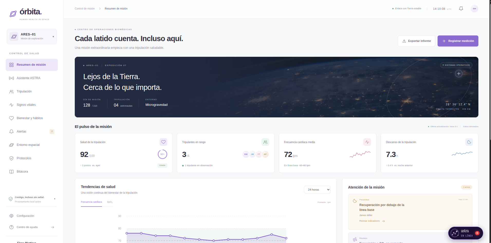
</p>

### Signos vitales — el astronauta en el centro
Modelo corporal interactivo con cinco sensores seleccionables (corazón, SpO₂,
temperatura, presión y respiración). Cuando la estación de hardware está activa, el
rótulo cambia a **EN VIVO** y las lecturas provienen de los sensores reales.

<table>
  <tr>
    <td>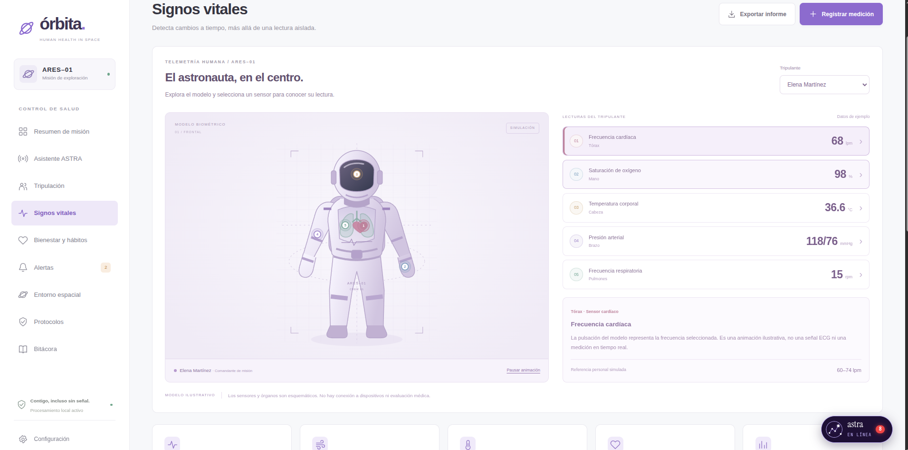</td>
  </tr>
  <tr>
    <td align="center"><em>Modelo biométrico con lecturas explicadas y línea base personal.</em></td>
  </tr>
</table>

### Tripulación — cuatro personas, cuatro líneas base
Cada tripulante tiene su propia referencia (primeros 14 días de misión), no promedios
genéricos. Estados, búsqueda y detalle individual.

<p align="center">
  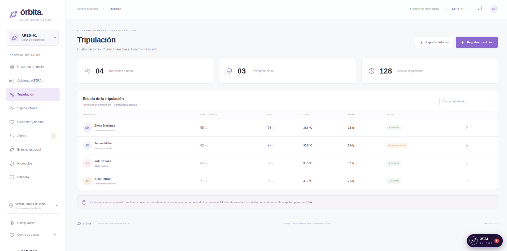
</p>

### Asistente ASTRA — acompañamiento emocional
Compañero de misión con voz: recordatorios de mediciones, guía de respiración, bitácora
rápida y semáforo de riesgo conductual (Nivel 0 Óptimo → Nivel 3 Fatiga crítica).

<p align="center">
  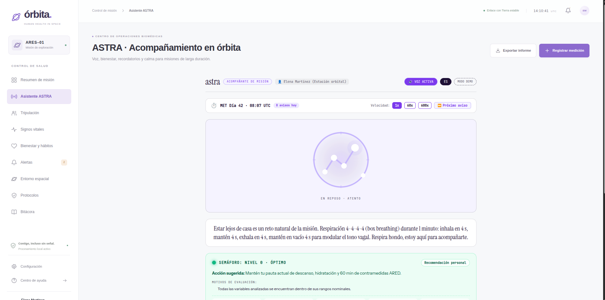
</p>

### Bienestar y hábitos — cuidar la mente también es parte del viaje
Sueño, recuperación de HRV, ejercicio, hidratación y exposición a luz por tripulante,
con la rutina diaria de la misión.

<p align="center">
  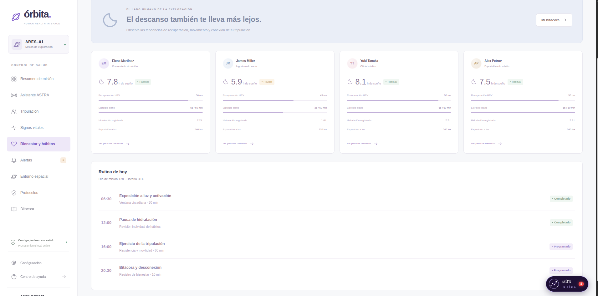
</p>

### Entorno espacial — el hábitat también enferma
CO₂ de cabina, radiación UV, temperatura y humedad. Con la estación conectada, estos
valores son telemetría real de los sensores.

<p align="center">
  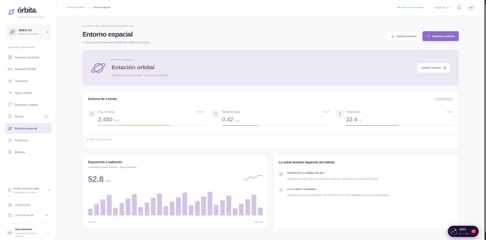
</p>

### Protocolos — claridad antes que improvisación
Listas de comprobación guiadas para monitoreo rutinario, fatiga, entorno y operación sin
conexión, más una guía honesta ante emergencias reales.

<p align="center">
  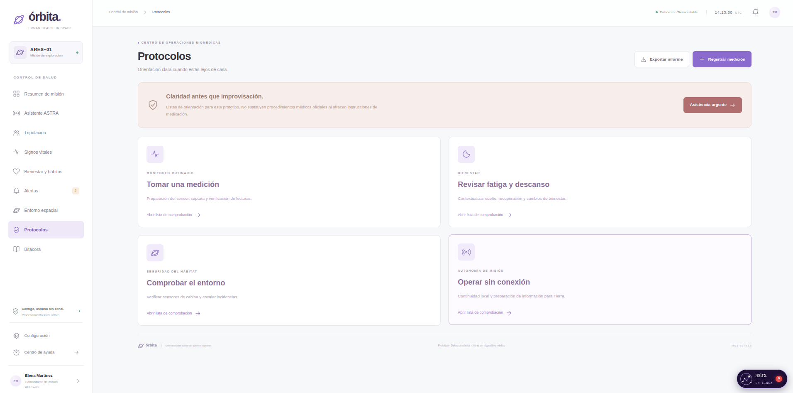
</p>

### Bitácora — un espacio para tomar perspectiva
Registro de estado de ánimo con persistencia local; alimenta la evaluación conductual.

<p align="center">
  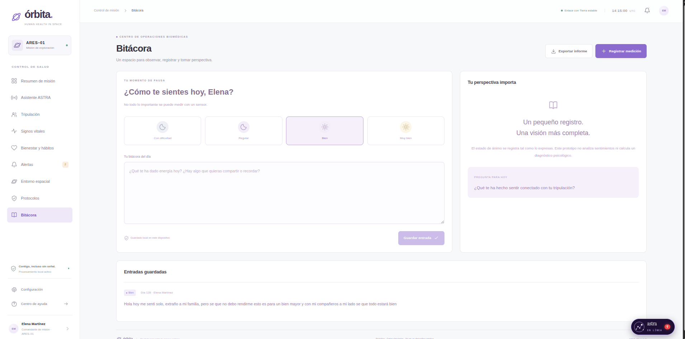
</p>

---

## 🔧 El hardware (estación de signos vitales)

La estación es un **ESP32** con pantalla OLED que lee sensores reales, muestra el estado
en cuatro pantallas rotativas (avatar + salud, vitales, ambiente, recomendación) y envía
todo por WiFi al servidor, que lo guarda en PostgreSQL. Incluye **alerta luminosa y
sonora** (LED RGB + zumbador) según el puntaje de salud.

### Componentes

<p align="center">
  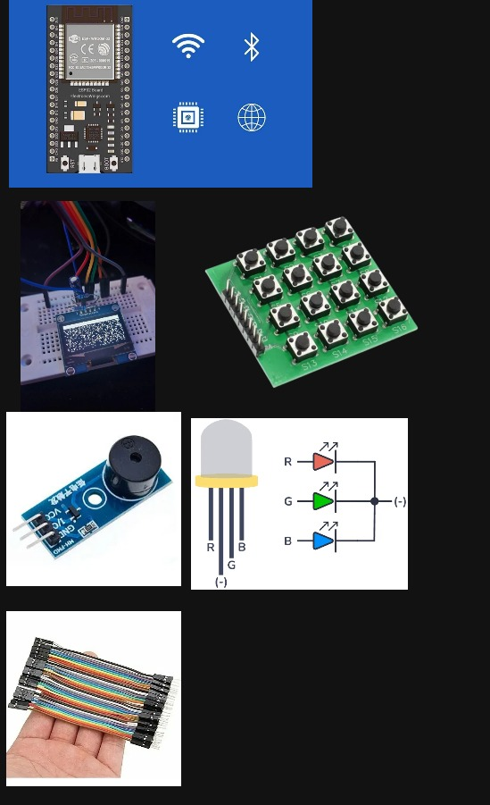
</p>
<p align="center"><em>ESP32 (WiFi + BLE) · OLED SH1106 · teclado matricial 4×4 · zumbador · LED RGB · cables.</em></p>

| Sensor / módulo | Qué mide |
| --- | --- |
| **AHT10/AHT20** (I2C) | Temperatura y humedad ambiente de cabina *(real)* |
| **ML8511 / CJMCU** | Radiación UV *(real)* |
| **Pulso, SpO₂, temp. corporal** | Signos vitales — simulados en la demo con caminata aleatoria en rangos médicos (listos para un **MAX30102**) |
| **OLED SH1106** | Avatar del astronauta + 4 pantallas de estado |
| **LED RGB + zumbador** | Semáforo físico verde/amarillo/rojo según salud |
| **Teclado 4×4** | Interacción y configuración local |

### La estación en acción

La OLED rota entre pantallas de estado y calcula un **puntaje de salud (%)** penalizando
cada parámetro fuera de rango; la cara del avatar cambia (feliz → serio → triste) según
la gravedad.

**Signos vitales y ambiente medidos, con envío confirmado al servidor (`POST 200`):**

<table>
  <tr>
    <td>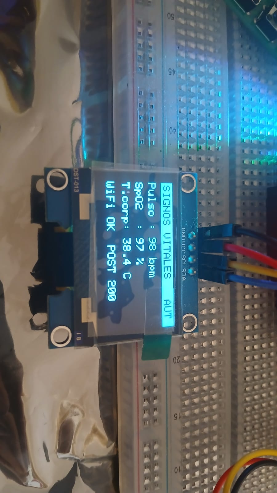</td>
    <td>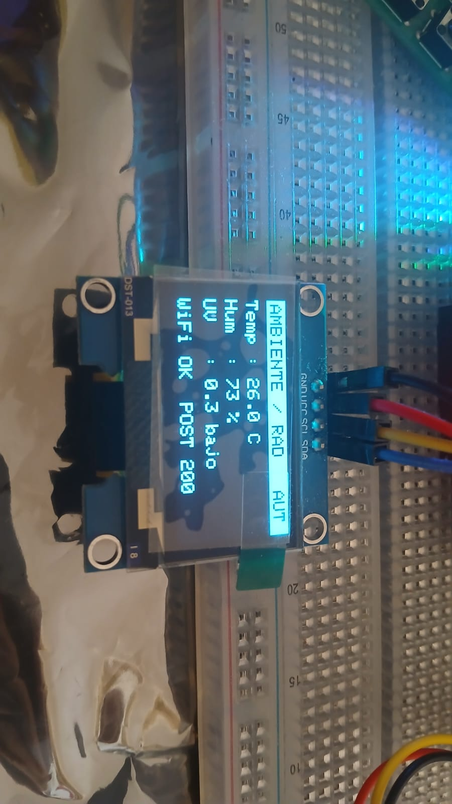</td>
  </tr>
  <tr>
    <td align="center"><em>Pantalla SIGNOS VITALES</em></td>
    <td align="center"><em>Pantalla AMBIENTE / RAD</em></td>
  </tr>
</table>

**El firmware también recomienda: cuando detecta un parámetro fuera de rango, sugiere
una acción concreta y activa la alerta física.**

<table>
  <tr>
    <td>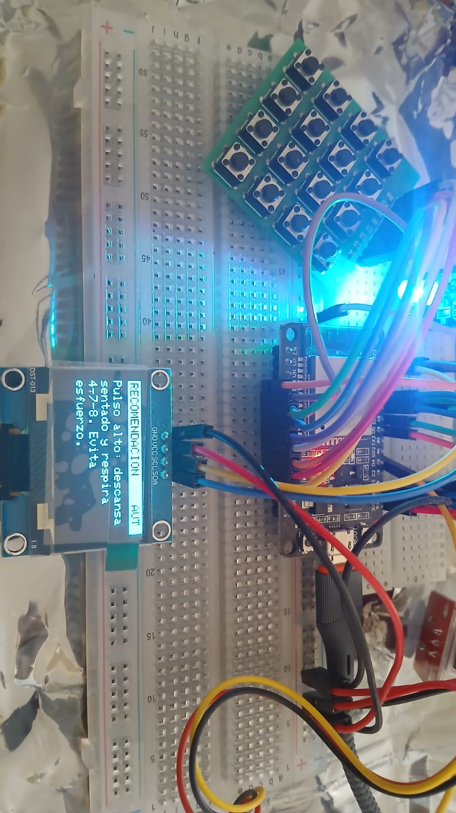</td>
    <td>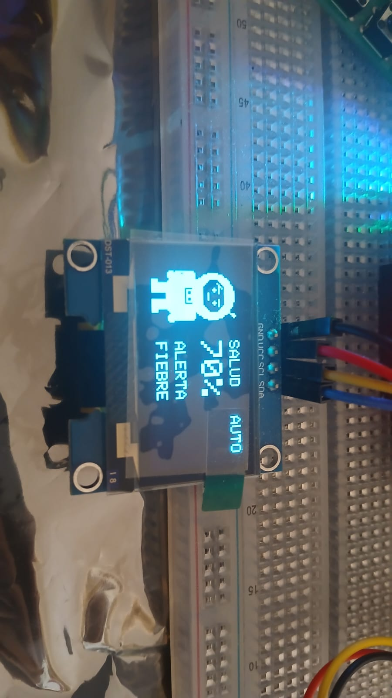</td>
  </tr>
  <tr>
    <td align="center"><em>Alerta: pulso alto → respiración 4-7-8</em></td>
    <td align="center"><em>Salud 70% → ALERTA FIEBRE</em></td>
  </tr>
  <tr>
    <td>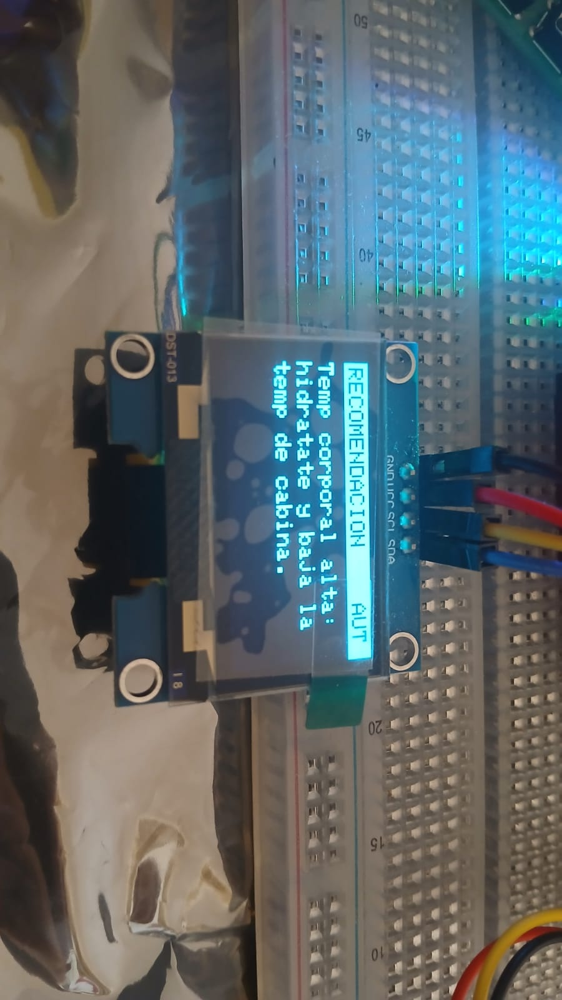</td>
    <td>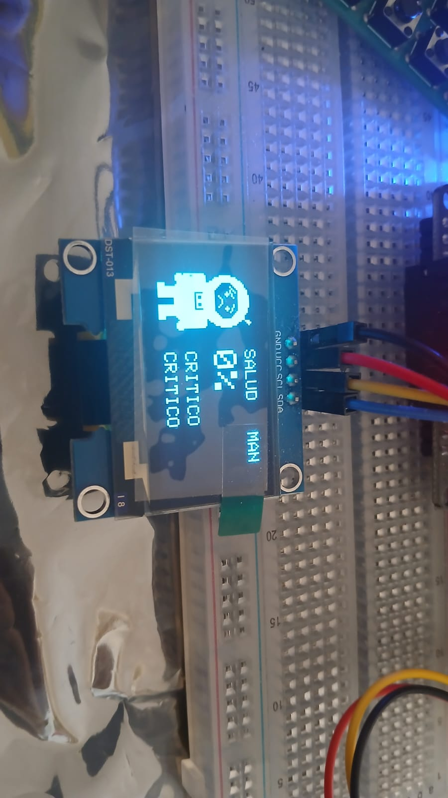</td>
  </tr>
  <tr>
    <td align="center"><em>Recomendación: hidratación</em></td>
    <td align="center"><em>Estado crítico → avatar triste</em></td>
  </tr>
</table>

---

## 🔄 Cómo se conecta todo

```
┌───────────────┐  WiFi   ┌──────────────┐        ┌──────────────┐   HTTP    ┌───────────────┐
│    ESP32      │ ─POST──▶│  Flask :5000 │ ─────▶ │  PostgreSQL  │ ◀──/api── │   Frontend    │
│ AHT · UV ·    │ /clima  │  (backend/   │        │  base 'ble'  │  proxy    │ React :5173   │
│ OLED · LED    │         │   servidor)  │        │ tabla clima  │  Vite     │ (polling 2 s) │
└───────────────┘         └──────────────┘        └──────────────┘           └───────────────┘
```

El frontend sondea `GET /api/clima` cada **2 segundos** (el proxy de Vite reenvía al Flask
sin CORS) y **fusiona los datos reales con los simulados**:

| Dato | Origen |
| --- | --- |
| Pulso, SpO₂, temperatura corporal, puntaje de salud | 🟢 BD del hardware (`clima`) |
| Temperatura de cabina, humedad, radiación UV | 🟢 BD del hardware (`clima`) |
| CO₂, sueño, HRV, ejercicio, alertas, tendencias, bitácora | 🔵 Simulados (sin sensor todavía) |

Si el servidor está apagado, el panel no se rompe: pasa a **modo demostración** y el
indicador superior cambia a "Datos de demostración". Cuando hay enlace, muestra
**"Estación de vitales en vivo"** y el modelo del astronauta se etiqueta **EN VIVO**.
Los campos `null` (sensor desconectado) nunca sobrescriben el último valor válido.

---

## 📁 Estructura del repositorio

```
├── frontend/                  # Aplicación web (React 19 + TypeScript + Vite 8 + Tailwind v4)
│   ├── src/
│   │   ├── types/             #   Tipos del dominio (contrato de datos)
│   │   ├── services/          #   Puertos de datos: HealthApi (misión) y TelemetryApi (hardware)
│   │   │   └── telemetryMapper.ts  # Traducción fila BD ➜ dominio (con tests)
│   │   ├── store/             #   Contextos globales: datos de misión, UI, avisos
│   │   ├── hooks/             #   useLiveTelemetry (polling 2s), persistencia local, reloj…
│   │   ├── components/        #   UI reutilizable, paneles, layout, modales
│   │   ├── features/          #   Una carpeta por página (dashboard, vitals, assistant…)
│   │   └── styles/            #   CSS organizado por capas
│   └── vite.config.ts         #   Proxy /api ➜ Flask (sin CORS en desarrollo)
│
├── backend/
│   ├── servidor/              # Servidor Flask + PostgreSQL (Python)
│   │   ├── servidor_ble_postgres.py  # Endpoints /clima, /datos + páginas HTML
│   │   ├── run.sh             #   Levanta el servidor con entorno virtual (auto-crea el venv)
│   │   └── setup_db.sh        #   Crea usuario/base/esquema de PostgreSQL (idempotente)
│   ├── db/                    # schema.sql (estructura), dump_completo.sql, clima.csv
│   ├── firmware/              # Código del ESP32 (Arduino/.ino): estación_vitales, clima_aht, ble…
│   └── docs/                  # Estado de la migración a Raspberry Pi
│
├── docs/
│   └── images/                # Capturas de la web y fotos del hardware (este README)
│
└── CONTRATO_DATOS_HARDWARE.md # Contrato de telemetría Raspberry ➔ frontend
```

**Principios del frontend**: arquitectura por *features* con puertos de datos desacoplados
(SOLID/DRY), funciones puras de mapeo con pruebas unitarias (Vitest) y degradación
elegante sin conexión. **El backend** mantiene la lógica de recepción en un único módulo
Flask y scripts idempotentes para reproducir el entorno en cualquier máquina.

---

## 🚀 Puesta en marcha

### 1. Backend (Flask + PostgreSQL)

```bash
cd backend/servidor
./setup_db.sh    # crea usuario + base + esquema (pide tu contraseña sudo; solo la primera vez)
./run.sh         # crea el venv, instala dependencias y levanta el servidor en :5000
```

> Los scripts usan un entorno virtual (`servidor/.venv`), evitando el error
> `externally-managed-environment` de pip en Ubuntu 24.04+.

Sin hardware conectado, puedes generar lecturas de prueba:

```bash
curl -X POST http://localhost:5000/clima -H "Content-Type: application/json" \
  -d '{"detector":"demo","temperatura":22.5,"humedad":48,"uv":1.3,"pulso":74,"spo2":98,"temp_corp":36.7,"sim":true,"salud":94}'
```

### 2. Frontend (React)

```bash
cd frontend
pnpm install     # solo la primera vez
pnpm dev         # http://localhost:5173
```

Si no tienes pnpm: `corepack enable pnpm` (o `npm i -g pnpm`).

### 3. Firmware (ESP32) — opcional

Ver `backend/README.md`: configurar WiFi e IP del servidor en
`firmware/estacion_vitales/estacion_vitales.ino` y subir con arduino-cli.

### Comandos útiles del frontend

```bash
pnpm typecheck   # comprobación de tipos
pnpm test        # pruebas unitarias (vitest)
pnpm build       # build de producción
```

---

## ✨ Funcionalidades destacadas

- **Panel de misión** con métricas agregadas, tendencias y alertas explicables.
- **Modelo corporal interactivo** conectado a la telemetría real del hardware.
- **Asistente ASTRA** con voz, guía de respiración y semáforo conductual (Nivel 0–3).
- **Alertas que explican su motivo** y sugieren una acción de revisión.
- **Operación sin conexión**: persistencia local, exportación CSV, protocolos offline.
- **Adaptable a entornos**: estación orbital, base lunar o marciana.

## 🤝 Impacto

Más allá del espacio, la misma arquitectura (hardware asequible + panel claro para no
expertos) puede inspirar herramientas de **telemedicina en comunidades aisladas** de la
Tierra con acceso limitado a servicios de salud.

---

*Desarrollado en NASA Space Apps Cochabamba · Datos simulados + telemetría real de la
estación ESP32 · Este prototipo no es un dispositivo médico.*
